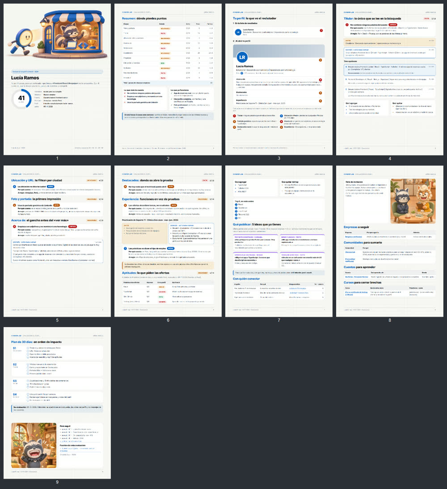

# 💼 linkedin-profile-review

**Evalúa un perfil de LinkedIn y entrega un informe firme, con cada arreglo ya escrito.**

Una skill de [Claude Code](https://claude.com/claude-code) de la comunidad [Chamba Lab](https://github.com/Chamba-Lab).

## ✨ Qué obtienes



*Informe de ejemplo con una persona ficticia (Lucía, frontend junior).*

Un `informe.pdf` (y su `informe.html`) con:

- nota de 0 a 100 y semáforo por sección
- maqueta del perfil con los errores marcados, como lo ve un reclutador
- titular, «Acerca de» y experiencia reescritos «antes → después», listos para copiar
- aptitudes que faltan frente a ofertas reales del puesto
- qué publicar, con quién conectar, qué empresas seguir y un plan de 30 días

El criterio cambia según el objetivo: buscar empleo, cambiar de trabajo o hacerse notar.

**Dos modos:** la evaluación completa y la **revisión rápida** (di «rápida», «lite» o «express»), de máximo 4 hojas, para revisar perfiles de quienes te lo piden.

## 🧩 Necesitas

- Claude Code con la extensión **Claude in Chrome**, y tu sesión de LinkedIn abierta en ese Chrome. El perfil se lee desde tu navegador, solo lectura y a ritmo humano: la skill nunca conecta, sigue ni reacciona.
- Node.js 18 o superior y Playwright con Chromium, para exportar el PDF:
  ```bash
  npm i -g playwright
  npx playwright install chromium
  ```

Instalación: mira el [README principal](../README.md#-instalar).

## 💬 Pídela así

```text
Evalúa mi perfil de LinkedIn: linkedin.com/in/mi-perfil. Busco trabajo de frontend junior, remoto desde Perú.
```

```text
Haz una revisión rápida del LinkedIn de mi amiga: linkedin.com/in/su-perfil
```

La primera vez te pregunta en qué carpeta guardar las evaluaciones y lo recuerda en `local.json`.

## 🔒 Privacidad

Si evalúas el perfil de otra persona, hazlo porque te lo pidió: según su configuración, puede verte en «Quién vio tu perfil». Los informes quedan en tu equipo; no los publiques sin su permiso.

## 📄 Licencia

Código y documentación bajo [licencia MIT](LICENSE). Rakim y sus ilustraciones no: mira [NOTICE.md](NOTICE.md).

Las escenas `assets/imagenes/escena-*.jpg` son copias recortadas del banco de recursos de los cortos de Rakim, de Chamba Lab.
